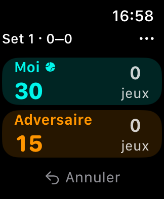
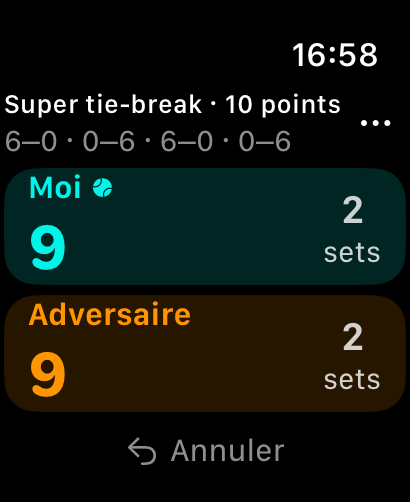

# Tennis Score

Application Apple Watch autonome et hors ligne pour compter les points de tennis en simple. Interface en français, compatible avec **watchOS 10 et plus**.

## Utilisation

- Configurer un match en 1, 2 ou 3 sets gagnants et choisir le premier serveur.
- Activer les avantages ou le point décisif. En 2 ou 3 sets gagnants, le dernier set peut être remplacé par un super tie-break en 10 points.
- Toucher « Moi » ou « Adversaire » pour attribuer un point. La montre vibre uniquement après une sauvegarde réussie.
- Utiliser « Annuler » pour retirer le dernier point, y compris après un jeu ou un set. Après la victoire, « Corriger le dernier point » rouvre le même match sans dupliquer son résultat.
- Le menu « … » permet de retourner à l’accueil ou d’interrompre le match. Un match interrompu conserve son score dans l’historique.
- À la réouverture, un match en cours est repris automatiquement. Les résultats sont consultables et supprimables dans l’historique.

Les sets normaux se jouent en six jeux avec deux jeux d’écart et un tie-break à 6–6, en sept points avec deux points d’écart. Les super tie-breaks exigent également deux points d’écart. Le serveur est calculé automatiquement, y compris à la sortie des tie-breaks.

## Ouvrir et lancer

1. Ouvrir `TennisScore.xcodeproj` dans Xcode 15 ou plus récent, avec les outils watchOS installés.
2. Choisir le schéma partagé **TennisScore**, puis un simulateur Apple Watch.
3. Lancer avec **Run**. Aucune application iPhone ni dépendance externe n’est nécessaire.
4. Pour une montre physique, sélectionner votre équipe dans **Signing & Capabilities**, adapter le bundle identifier si nécessaire, puis choisir votre montre comme destination. La version livrée ne contient aucun identifiant de signature personnel.

Si les Command Line Tools sont sélectionnés par défaut, utiliser le Xcode complet sans changer la configuration globale du Mac :

```sh
export DEVELOPER_DIR=/Applications/Xcode.app/Contents/Developer
```

## Tests et compilation

Le moteur et la sauvegarde se testent sur Mac sans simulateur :

```sh
DEVELOPER_DIR=/Applications/Xcode.app/Contents/Developer xcrun swift test
```

Compiler pour le simulateur sans signature :

```sh
DEVELOPER_DIR=/Applications/Xcode.app/Contents/Developer xcodebuild \
  -project TennisScore.xcodeproj -scheme TennisScore \
  -configuration Debug -sdk watchsimulator \
  -destination 'generic/platform=watchOS Simulator' \
  -derivedDataPath /tmp/tennis-score-build CODE_SIGNING_ALLOWED=NO build
```

Compiler la version montre en Release sans signature :

```sh
DEVELOPER_DIR=/Applications/Xcode.app/Contents/Developer xcodebuild \
  -project TennisScore.xcodeproj -scheme TennisScore \
  -configuration Release -sdk watchos \
  -destination 'generic/platform=watchOS' \
  -derivedDataPath /tmp/tennis-score-device-build CODE_SIGNING_ALLOWED=NO build
```

Le schéma de l’application sert à lancer et compiler l’interface ; les tests du package se lancent avec `swift test` ou en ouvrant `Package.swift` dans Xcode.

## Organisation et sauvegarde

- `Sources/TennisCore` : règles et moteur déterministe, journal des points, historique et transactions de sauvegarde.
- `WatchApp` : écrans SwiftUI, navigation et retours haptiques. Les mutations passent par le `MatchStore` sur l’acteur principal.
- `Tests/TennisCoreTests` : tests des scores, serveurs, annulations, rechargements et erreurs de stockage.
- `Scripts/generate-icon.swift` : source de l’icône ; exécuter `xcrun swift Scripts/generate-icon.swift` depuis la racine pour la régénérer.

Les données sont stockées uniquement dans `Application Support/TennisScore/matches.json`, à l’intérieur du conteneur de l’application sur la montre. Un seul document JSON versionné contient le match en cours et l’historique ; chaque modification le remplace atomiquement avant d’être acceptée dans l’interface. Les scores et le serveur sont reconstruits depuis les points enregistrés. Une sauvegarde illisible ou d’une version inconnue bloque les modifications et reste intacte, avec possibilité de réessayer sa lecture.

L’historique n’est pas synchronisé ni sauvegardé sur un serveur. Supprimer l’application peut supprimer ses données locales.

## Vérification sur montre

Validation effectuée avec Xcode 27.1 : **28 tests réussis**, compilation Debug pour les simulateurs et Release pour watchOS (sans signature). Le lancement, la restauration d’un match et l’affichage du score ont été contrôlés par captures sur Apple Watch SE 40 mm et Ultra 2 49 mm, sous watchOS 11.1.

L’application graphique Simulator est absente de cette installation Xcode : les gestes, les dialogues et VoiceOver restent à vérifier interactivement. Les vibrations et Always On doivent être vérifiés sur une montre physique.

| Score classique · 40 mm | Super tie-break · 49 mm |
| --- | --- |
|  |  |

Avant de l’utiliser en match, vérifier sur votre montre :

- Les deux zones de score et l’annulation restent accessibles, y compris avec une grande taille de texte et VoiceOver.
- L’attribution d’un point, le changement de serveur et la vibration correspondent aux gestes.
- Quitter l’application, la relancer et retrouver le même score.
- Terminer un match, corriger le dernier point, puis terminer à nouveau : un seul résultat apparaît dans l’historique.
- Interrompre puis supprimer un match en passant par les confirmations.
- Sur une montre compatible, vérifier la lisibilité en Always On. La durée avant retour au cadran dépend du réglage watchOS **Retour à l’heure** ; l’application ne force pas une session sportive en arrière-plan.

Cette première version ne comprend pas le double, la synchronisation iPhone/iCloud, Apple Santé ni la publication App Store.
